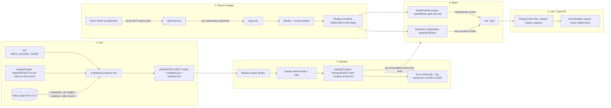

# Creative pipeline: pull ads, review them, make new ones

How HiddenGem turns a client's Meta ad account into a ranked creative review and then into new ad creatives, end to end. Written so the whole thing can be lifted into another project: every stage lists its inputs, outputs, commands, and the tools and Claude Code skills it leans on.

First full run: FLOHOM, 19 October 2026 (pull, review, one National Harbor girls-trip reel).

## 1. Overview



The review decides what to build; the clip library decides what it can be built from. Nothing in stages 3 to 5 is specific to FLOHOM except the folder IDs and the captions.

## 2. Stage 1: pull the top and bottom ads

**Script:** `scripts/pull-creatives.mts` (87 lines, no dependencies beyond Node 24 and `tsx`).

```
npx tsx scripts/pull-creatives.mts <client name> [YYYY-MM-DD] [--out DIR]
npx tsx scripts/pull-creatives.mts FLOHOM 2026-10-19
```

**Inputs**

| Input | Where | Notes |
|---|---|---|
| Meta Marketing API token | `META_ACCESS_TOKEN` in `.env` (loaded by the script, `.env.local` first) | Same token path as the weekly ad spend, pixel and benchmark checks since 2026-10-19. Needs `ads_read`; Page-owned reels also need the Page's token, which the script fetches read-only. |
| Client to ad account map | `weekly/Project Data/PROJECT.md` section 5, a Markdown table `Client \| AM \| Ad account \| ID \| Connector` | The script matches the client name case-insensitively and takes the numeric ID column. To port: keep this table shape or swap the `account()` function for your own registry. |

**Rules (set by Shawal, 2026-10-19)**

- Sales campaigns only: `objective == OUTCOME_SALES`.
- Window: `date_preset=last_30d`, insights at `level=ad`.
- Spend floor: ads under $100 are listed in the manifest as `under_min_spend` but not ranked.
- Ranking: purchase ROAS, then purchases, then spend. Top 3 and bottom 3 are downloaded.

**Graph API calls, in order**

1. `act_<id>/campaigns?fields=id,name,objective,effective_status` to find the sales campaigns.
2. `act_<id>/insights?level=ad&date_preset=last_30d&fields=spend,impressions,reach,frequency,ctr,inline_link_clicks,cost_per_inline_link_click,actions,action_values,purchase_roas` for every ad. Purchases, value and ROAS come from the `omni_purchase` action type; add-to-cart and checkout are kept too.
3. Per picked ad: `<ad_id>?fields=creative{id,name,image_url,thumbnail_url,video_id,object_story_spec,asset_feed_spec}`. Copy (primary text, headline, description, link, CTA) is read from `link_data`, then `video_data`, then `asset_feed_spec`.
4. Media by kind:
   - **video**: `<video_id>?fields=source,length,from`. If `source` is missing because the Page owns the video, fetch `<page_id>?fields=access_token` and retry with that page token (GET only). Also a 1080 thumbnail from the creative.
   - **carousel**: each `child_attachments[]` card's `picture`, or `act_<id>/adimages?hashes=[...]` when only an `image_hash` is present.
   - **image**: `creative.image_url`, else the `link_data.image_hash` or `asset_feed_spec.images[0].hash` through `adimages`.

**Outputs** in `weekly/Creative Reviews/pulls/<date>/<client>/` (gitignored, re-pullable):

- `01_top_<ad name>.jpg`, `02_top_<ad name>.mp4` + `_thumb.jpg`, `03_top_<ad name>_card1..8.jpg`, `04_bottom_...` and so on. The number is the rank position, `top`/`bottom` the bucket.
- `manifest.json`: client, account, AM, run date, rule, every picked ad's metrics, copy, files, source URLs and notes (for example "video owned by Page X, read with a page-scoped token").
- `manifest.md`: the same as a ranking table plus a Copy section per ad, which is what the reviewer reads.

## 3. Stage 2: review the creatives

There is no script for this stage. It is Claude reading the manifest and the frames, then writing the review in a fixed shape.

**Looking at video ads.** ffmpeg turns a reel into one contact sheet that Claude can read as an image:

```
ffmpeg -y -i 02_top_reel.mp4 -vf "fps=1,scale=270:-1,tile=6x3" 02_top_reel_contact.jpg
```

One frame per second, six per row. That is enough to read the scene order, caption placement, caption size and the close card. Images and carousel cards are read directly.

**Reading the numbers.** The manifest table plus the under-floor list. Two things to say every time: how many purchases the top ROAS rests on (two or three purchases means one booking reorders the list), and which zero-purchase ads spent real money (the firmer signal).

**Review document** at `weekly/Creative Reviews/<date>-<client>-creative-review.md`, sections in this order:

1. Scope line (campaign types, spend floor, ranking rule, how many qualified and how many sat under the floor).
2. Ranking table: #, ad, campaign, format, spend, purchases, ROAS, CTR, frequency.
3. What the winners share (one bullet per ad, naming the concrete device: the price anchor, the story structure, the social proof).
4. What the losers share (same, with the dollar amount that bought nothing).
5. Copy: what is being tested, what is identical across ads.
6. Recommendations for the next cadence, numbered, each one buildable.
7. Process notes from the run (commands used, what could not be uploaded, next clients).

**Sharing.** The review doc and the images go to Drive under `Meta Ads - Top Performers / <date> <client>` through the Google Drive connector (`create_file`). Video files cannot pass through the connector, since the bytes would go through the model. Options recorded on 2026-10-19: a Zapier Google Drive "Upload File" action fed a file URL, or a manual drop.

## 4. Stage 3: source footage from the client's clip library

The FLOHOM library is the Drive folder "Reels Components" (`10FevapasZtsuQyDsBxyfBhgtBMn4j13s`). Its useful branches:

| Branch | Folder ID | What is in it |
|---|---|---|
| Reel Automation / Organized Clips | `1NV3Kx__NxPrKpdte65JQhHoUOTNeG3TD` | One folder per boat or location and audience: `National Harbor-Girls Group`, `National Harbor-Couples`, `FLO13-Baltimore-Girls Group`, `FLO16-Jersey City-Groups`, and so on |
| Organized Clips / National Harbor-Girls Group | `1-hKY9I4kHjcRq1nAKBxGbYxvm8UOzN_h` | 22 clips: the AI people shots (1080x1080, 1 to 3 s) plus copies of the 9:16 b-roll |
| Organized Clips / Add-Ons General | `13TbIVfNPPrQKGUoOQ__DVRwvqx9vx6Ua` | Private chef and spa/massage clips (`FLOHOM-Private Chef-CF-Clip1..3`, `FLOHOM-Spa&Massage-CF-Clip2..3`, `Massage.mp4`) |
| CF Clips / Sept 2026 / `<location> - Twilight` | e.g. `1GHBT9gH_S47mx4-CzPAaMWwJKuSlPnMl` | Blue-hour 9:16 b-roll, 5 s each, the best hook and close backgrounds |
| CF Clips / Sept 2026 / `<location>` | e.g. `1p98uwDkfrukjmLHwvOmDIRNc8ZjtU09D` | Daytime and golden-hour 9:16 b-roll (interiors, deck, skyline) |

Naming: `*-CF-Clip<n>.mp4` files are 1080x1920, 30 fps, 5 s b-roll. `FLOHOM <n> - <location> (<k>).mp4` and `National Harbor, MD (<k>).mp4` are the 1080x1080 real-people shots.

**Listing.** The Google Drive MCP `search_files` with `parentId = '<folder id>'` and `excludeContentSnippets: true`, paging with `pageToken`. It returns names, sizes, MIME types and IDs; that is the inventory.

**Downloading.** The Drive MCP `download_file_content` returns base64 through the model, which is unusable for video. Link-shared files download straight to disk instead:

```
curl -sL -o clip.mp4 "https://drive.usercontent.google.com/download?id=<FILE_ID>&export=download&confirm=t"
```

`confirm=t` skips the virus-scan page on files over a few MB. If the result starts with `<!doctype html>` the file is not link-shared (`file -b clip.mp4` says "HTML document"); on 2026-10-19 that was the case for `Completed AI Reels`, the top-level `Add-Ons General` folder and `Add-Ons/References`, while the same clips under `Organized Clips` downloaded fine.

**Inventory and selection.** `ffprobe` for size, frame rate and duration, then a contact sheet per clip and one stacked sheet per group so Claude can see every clip at once:

```
# six evenly spaced frames per clip, one strip each
ffmpeg -y -i clip.mp4 -frames:v 1 -vf "fps=6/<duration>,scale=200:356:force_original_aspect_ratio=decrease,pad=200:356:(ow-iw)/2:(oh-ih)/2:black,tile=6x1:padding=2" strips/clip.png
# stack strips (bash, not zsh: zsh does not word-split an argument string)
ffmpeg -y -i strips/a.png -i strips/b.png -filter_complex "[0:v][1:v]vstack=inputs=2[o]" -map "[o]" sheet.jpg
```

**Normalising.** Every chosen clip becomes the same format before it enters a composition, which also removes HEVC `.MOV`, 29.97 fps and square frames as variables:

```
ffmpeg -y -i in.mov -an -vf "scale=1080:1920:force_original_aspect_ratio=increase,crop=1080:1920,fps=30,format=yuv420p" \
  -c:v libx264 -preset fast -crf 18 -movflags +faststart out.mp4
```

Square people clips are centre-cropped to 9:16 (the subjects sit centred, confirmed with a crop-check sheet). The HyperFrames build used a blurred 9:16 fill instead of a crop for the same clips; either works, pick one per project.

**Claims.** Anything the captions assert is checked against the client's site, not the reference ad. `WebFetch` on `flohom.com/listings` showed the National Harbor boats sleep 2 to 4, so the caption says "up to 4 guests" where the Myrtle Beach reel said "4 to 6".

## 5. Stage 4: build the new ad

The brief comes from recommendation 1 of the review: copy the structure of the winning reel for another location. The structure, read off the Myrtle Beach contact sheet:

| Beat | Seconds | Caption | Footage |
|---|---|---|---|
| Hook card | 0 to 3 | "Girls Trip on the Water 🌊🥂" + location | twilight marina or skyline |
| Occasion | 3 to 6 | "the perfect backdrop for birthdays and special moments ✨🎂" | people on the rooftop, a toast |
| Rooftop at dusk | 6 to 8 | "sunset views from your private rooftop 🌅" | deck at blue hour |
| Add-on | 8 to 11 | "add-on a private chef or spa services ✨" | cocktail pour, chef, nail tech |
| Interiors | 11 to 14 | "ft. luxury interiors for up to 4 guests" | living room, kitchen, bedroom |
| Close | 14 to 18 | "Use code VIP100 to Save $100! 👇" | lit boat at night |

Captions: Poppins 700, white, dark drop shadow, centred in the upper third, pop in with a spring, one emoji at most per line. Total 15 to 20 s, 1080x1920, 30 fps, no audio bed (music is added in Ads Manager).

Two implementations exist in the repo. They produce the same reel; keep whichever toolchain the next project already uses.

### 5a. Remotion (`video/`)

Scaffolded with `npx create-video@latest --yes --hello-world video`, npm, Remotion 4.0.537. Extra packages pinned to the same version: `@remotion/transitions`, `@remotion/google-fonts`.

- Composition: `video/src/flohom/NationalHarborGirlsTrip.tsx`, registered in `video/src/Root.tsx` as `FLOHOM-NH-GirlsTrip`. Scenes are a data array (`file`, `frames`, `trimBefore`, `caption`, `zoom`); captions are a keyed map, so a new occasion is a caption and clip swap.
- Clips: `<OffthreadVideo src={staticFile("flohom-nh/<name>.mp4")} trimBefore={…} muted>` inside `<TransitionSeries>` with 8-frame `fade()` transitions. `startFrom`/`endAt` are deprecated in this version; use `trimBefore`/`trimAfter`.
- Captions are a separate layer computed from absolute frame ranges so they span the fades.
- Normalised clips live in `video/public/flohom-nh/` (59 MB, untracked).
- `remotion.config.ts` sets `Config.setChromeMode("chrome-for-testing")`: the default headless shell crashes under the sandboxed shell on this Mac ("Target closed", GPU process exit 6). Full Chrome renders fine and the first run downloads it.

```
cd video && npx tsc --noEmit
cd video && npx remotion render FLOHOM-NH-GirlsTrip out/flohom-nh-girls-trip.mp4
```

### 5b. HyperFrames (`video/flohom-girls-trip-reel/`)

Built with the `hyperframes@hyperframes` Claude Code plugin (0.8.177) through its `/hyperframes` entry skill and the `general-video` workflow with `flow: automation`.

- `BRIEF.md` carries the intent as front matter (workflow, destination, aspect, length, audience, angle) plus Intent, Assets, Customizations and Notes sections. This is the file to copy and edit for the next occasion.
- `index.html` is one composition: 10 muted `<video class="clip">` elements on track 0 with `data-start`, `data-duration`, `data-media-start`; 7 caption `<div class="clip caption">` elements on track 2; 17.7 s.
- `assets/` holds the staged clips; `renders/` the MP4s and render logs; `hyperframes.json` points the registry and asset paths.
- CLI on this machine: `npx hyperframes` is replaced by the plugin launcher, run from the project directory:

```
node ~/.claude/plugins/cache/hyperframes/hyperframes/0.8.177/skills/hyperframes/scripts/plugin-cli.mjs check
node ~/.claude/plugins/cache/hyperframes/hyperframes/0.8.177/skills/hyperframes/scripts/plugin-cli.mjs render
```

Skills used from the plugin: `hyperframes` (routing and brief), `general-video` (authoring), `hyperframes-core` (the clip and track contract), `hyperframes-animation` (caption entrances), `hyperframes-cli` (check and render). `media-use` could source a music bed but needs a signed-in `heygen` CLI or a local MusicGen, neither of which is set up.

## 6. Stage 5: QA and hand off

1. Tile the render and read it: `ffmpeg -i reel.mp4 -vf "fps=2,scale=216:384,tile=6x7:padding=2" sheet.jpg`, then pull four full-size frames at the caption changes and read those too. Check: font loaded (not a fallback sans), emoji rendered in colour, trims right (no stray first shot), captions clear of faces, fades clean.
2. Check every claim in the captions against the client's site or the review doc. Do not invent amenities, prices or guest counts.
3. Hand off the MP4 path, the structure table, the judgment calls, and what is missing (music, further variants). Upload to Ads Manager is manual.

## 7. Tools and skills, by stage

| Stage | Claude Code tools | Skills / plugins | CLI and packages | External services |
|---|---|---|---|---|
| 1 Pull | Bash | none (script) | Node 24, `npx tsx`, `scripts/pull-creatives.mts` | Meta Graph API v21.0 (`META_ACCESS_TOKEN`), page-scoped token for Page reels |
| 2 Review | Bash, Read (images), Google Drive connector `create_file` | none; the review template above | ffmpeg contact sheets | Google Drive (doc and images); Zapier Drive upload for video |
| 3 Source | Google Drive connector `search_files` (listing), Bash, Read, WebFetch (claims) | none | curl, ffprobe, ffmpeg, bash for stacking | Google Drive link-shared files; client website |
| 4 Build | Bash, Read | Remotion: none. HyperFrames: `hyperframes`, `general-video`, `hyperframes-core`, `hyperframes-animation`, `hyperframes-cli` | Remotion 4.0.537 (`remotion`, `@remotion/cli`, `@remotion/transitions`, `@remotion/google-fonts`), Chrome for Testing; HyperFrames 0.8.177 plugin launcher | Google Fonts (Poppins) |
| 5 QA | Bash, Read | none | ffmpeg, ffprobe | none |
| Context | Supabase connector | `client-benchmark`, `ad-spend-check`, `pixel-domain-check` | | `roi` schema in HGM Reporting for monthly ROI context when the review needs it |

Machine notes: no Homebrew; ffmpeg 7.0, ffprobe and git-lfs live in `~/.local/bin`. Pillow is installed without raqm (no emoji text rendering); Swift and CoreText can render caption PNGs with colour emoji if a non-browser path is ever needed.

## 8. Porting checklist for another project

1. Copy `scripts/pull-creatives.mts`. Give it a client registry: either a `PROJECT.md` with the section 5 table or replace `account()` with your own lookup. Put `META_ACCESS_TOKEN` in `.env`.
2. Decide the ranking rules in the script header (`OUTCOME_SALES`, `MIN_SPEND`, `TOP`, `date_preset`). Lead-gen clients need a different objective and conversion action.
3. Create `Creative Reviews/` with `pulls/` gitignored. Write reviews as `<date>-<client>-creative-review.md` in the section order above.
4. Record the client's clip library: root folder ID, the organised sub-folders, which ones are link-shared. Test one `curl` download before planning around a folder.
5. Pick one build toolchain. Remotion: `npx create-video@latest --yes --hello-world <dir>`, add the chrome-for-testing line, copy the composition file as a template. HyperFrames: install the plugin, copy `BRIEF.md`, run `/hyperframes`.
6. Keep the caption identity (Poppins 700, white, shadow, upper third) unless the client's winning ad shows something else; the point of the pipeline is to copy what already converts.
7. Known traps: zsh does not word-split `$args` (use a bash script for multi-input ffmpeg); ffmpeg `drawtext` with inline `text=` fails on this build, `textfile=` works; `.MOV` add-on clips are HEVC and 29.97 fps, normalise before use; the Drive connector cannot move video bytes; the headless shell needs `chrome-for-testing` inside a sandboxed shell; unsandboxed Bash is refused by the permission classifier, so do not plan on it.

## 9. Run log

| Date | Client | Pull | Review | Build |
|---|---|---|---|---|
| 2026-10-19 | FLOHOM | 9 ads ranked, 14 under $100; 6 downloaded (2 images, 2 videos, 2 carousels) | `2026-10-19-flohom-creative-review.md`, Drive doc "Creative review - FLOHOM - 2026-10-19" | Girls-trip reel for National Harbor, HyperFrames v1/v2 (17.7 s) and Remotion (18.2 s) |
| 2026-10-22 | 18 advanced-setup accounts | 90-day organic reels pull for all 19 Pages (top 4 each, Shazam on #1/#2); Drive clip libraries inventoried and 10 clips staged per client | `weekly/IG Reel Reviews/2026-10-22-advanced-clients-reels.md` | One spec-driven Remotion reel per account (`video/specs/<slug>.json`, 5-6 beats, 16-19.5 s) with the client's own hook and track; Ridge & Falls and American River blocked on Drive sharing |

Next clients named in the review: Stay on 30a, Tàberg Falls, Paradise Pointe (after its purchase-value fix), The Cohost Company.

## 10. Added 21 October 2026: organic reels scan and music

Two stages bolted on after the first run. Full first-run write-up: `weekly/IG Reel Reviews/2026-10-21-flohom-reels-review.md`.

**Organic reels pull.** `npx tsx scripts/pull-ig-reels.mts <client> [date] [--days 90] [--top 5]`. Resolves the client's Facebook Page by name on the system user, reads the linked Instagram account through the Page's own token (the user token does not expand it), lists reels in the window, pulls per-reel insights (`views, reach, saved, shares, likes, comments, total_interactions, ig_reels_avg_watch_time`), ranks by views over the account median, downloads the top N with yt-dlp (the API withholds `media_url` on licensed-audio reels), extracts the audio track, builds a contact sheet, and writes `manifest.json` + `manifest.md` under `weekly/IG Reel Reviews/pulls/<date>/<client>/` (gitignored). Needs `instagram_basic` and `instagram_manage_insights` on the token; 47 of 48 client Pages are linked.

**Audio identification.** shazamio in a throwaway venv (`python3 -m venv shz && shz/bin/pip install shazamio`), run over the `_audio.m4a` files; returns title, artist, label, ISRC. Classify each as original, sound-collection, licensed or library in `weekly/IG Reel Reviews/music-ledger.md`.

**Adding music to a reel.** `scripts/add-music.sh <silent.mp4> <track> <out.mp4> [--start s] [--fade-in s] [--fade-out s] [--lufs -14]`: loops the track with a 1 s crossfade when shorter than the reel, trims, fades, normalises to -14 LUFS, copies the video stream. Always keep the silent master; a rejected track is a one-command swap.

**Licensing stance.** Commercial tracks from the client's own reels are organic-only licences. Shawal's decision on 21 October: use them on ads and let Ads Manager review be the gate, with the ledger holding the class and the outcome so a cleared fallback (Sound Collection or library) can replace a rejected or muted track.

Tools added to the matrix: Instagram Graph API (same token), yt-dlp, shazamio, ffmpeg `acrossfade` + `loudnorm`.

## 11. Status on 21 October 2026 (paused; resume early November)

Done: FLOHOM creative review, FLOHOM reels scan, three reel cuts (v2 approved, v3 share-hook variant), music variants A/B/C, IG export pass, this doc, the two overview diagrams. Upload-ready file: `video/out/flohom-nh-girls-trip-v3-music-B-IG.mp4` (and the v2 equivalent after running `scripts/ig-export.sh` on it).

When resuming:
1. Record the Ads Manager verdict on the Feel good track in `weekly/IG Reel Reviews/music-ledger.md`; if rejected or muted, swap with `scripts/add-music.sh` and re-run `scripts/ig-export.sh`.
2. Ask AnhTuan where the FLOHOM music files live in Drive (WorkLog mentions a set the Reels use) and check `Client Content/FLOHOM/Shared Content/Completed Reels/2026` for textless masters of the top organic reels.
3. Run `pull-ig-reels.mts` and `pull-creatives.mts` for the next clients: Stay on 30a, Tàberg Falls, Paradise Pointe, The Cohost Company.
4. Learnings from the Content Drive to carry into every build (details in memory and section 10): share-CTA hooks, establishing shot inside 3 s, people in at most 10 to 20% of shots except group stays, music style by audience, 15 Mbps CBR export with unsharp and grain.
5. Source clips are not in git. Re-pull with the folder IDs in section 4, or run the normalise command on the clips in `video/flohom-girls-trip-reel/assets/` if that folder still exists locally.


## 12. Added 22 October 2026: one reel per advanced-setup client

Scaled the FLOHOM build to every advanced-setup account in one pass. Write-up with per-client hooks, clips, Drive IDs and tracks: `weekly/IG Reel Reviews/2026-10-22-advanced-clients-reels.md`.

**Spec-driven compositions.** A reel is now a JSON file in `video/specs/<slug>.json` (`client`, `beats[]` of `{file, seconds, lines, sub?, size?, trimBefore?, playbackRate?}`, `music`, `music_start`). `scripts/build-reel-specs.mjs` writes them into `video/src/flohom/specs.generated.ts`, and `video/src/Root.tsx` registers a `Reel-<slug>` composition for each one on `video/src/flohom/ClientReel.tsx` (approved v2 style: hard cuts, static Poppins captions, hook card, offer close). Staged clips live in `video/public/<slug>/NN_<name>.mp4` (gitignored).

**One-command delivery.** `scripts/render-reels.sh [slug …]` renders the silent master, lays the spec's track with `add-music.sh`, and runs `ig-export.sh`; outputs land in `video/out/clients/<slug>{,-music,-IG}.mp4`. Run renders sequentially: two concurrent Remotion renders fight over the bundle server and one fails with "Visited localhost:3000 but got no response".

**Footage sourcing at scale.** The Drive connector lists any client folder, but files download anonymously only when their folder is shared by link (`drive.usercontent.google.com/download?id=<id>&export=download&confirm=t`; an HTML or HTTP 400 reply means not shared). Staging script picks up to 3 twilight clips plus the rest from the library, normalises to 1080x1920/30 fps, and writes a 6-frame strip per clip into one contact sheet for the shot selection. Clips in client folders that are not link-shared cannot be fetched this way; ask the AM to share the folder or hand over the files.

**Music at scale.** Shazam over the #1 and #2 reel audio of every account; the spec points at the source reel's `_audio.m4a`, so the track in the ad is the one that already performed organically for that client. All 18 tracks are commercial releases (class `licensed`) and sit in the ledger with outcome pending.

**Variants and the live-ad check (22 Oct, later).** Before a cut goes to the team, frame-strip the client's top live ads (`weekly/Creative Reviews/pulls/<date>/<client>/0N_top_*.mp4`, 7 frames each) next to the reel's QA strip and compare hook wording, opening shot and feature order. Same-library footage will always overlap; the hook line and the opening shot must not. A B variant per client (`<slug>-b.json`, `dir: <slug>`) changes the angle, the opening clip and the track. The review pack is assembled from `video/out/clients/*-IG.mp4` into `video/out/team-review-<date>/<Client>/` with the top live-ad thumbnail and a README.
